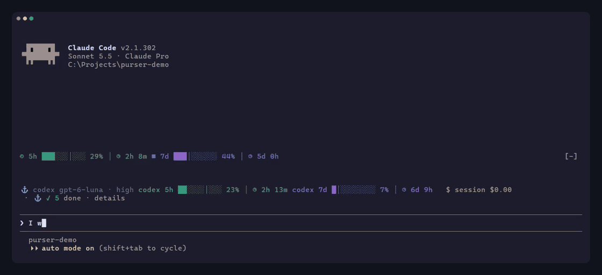

<div align="center">
<h1>Purser</h1>
<h4>Purser coordinates delegated coding work for Claude Code.</h4>

    [](https://github.com/neurot1ca/purser-claude-orchestrator/releases)

 ![Codex](https://img.shields.io/badge/Codex-supported-000000?logo=data:image/svg%2bxml;base64,PHN2ZyBmaWxsPSJ3aGl0ZSIgcm9sZT0iaW1nIiB2aWV3Qm94PSIwIDAgMjQgMjQiIHhtbG5zPSJodHRwOi8vd3d3LnczLm9yZy8yMDAwL3N2ZyI+PHRpdGxlPk9wZW5BSTwvdGl0bGU+PHBhdGggZD0iTTIyLjI4MTkgOS44MjExYTUuOTg0NyA1Ljk4NDcgMCAwIDAtLjUxNTctNC45MTA4IDYuMDQ2MiA2LjA0NjIgMCAwIDAtNi41MDk4LTIuOUE2LjA2NTEgNi4wNjUxIDAgMCAwIDQuOTgwNyA0LjE4MThhNS45ODQ3IDUuOTg0NyAwIDAgMC0zLjk5NzcgMi45IDYuMDQ2MiA2LjA0NjIgMCAwIDAgLjc0MjcgNy4wOTY2IDUuOTggNS45OCAwIDAgMCAuNTExIDQuOTEwNyA2LjA1MSA2LjA1MSAwIDAgMCA2LjUxNDYgMi45MDAxQTUuOTg0NyA1Ljk4NDcgMCAwIDAgMTMuMjU5OSAyNGE2LjA1NTcgNi4wNTU3IDAgMCAwIDUuNzcxOC00LjIwNTggNS45ODk0IDUuOTg5NCAwIDAgMCAzLjk5NzctMi45MDAxIDYuMDU1NyA2LjA1NTcgMCAwIDAtLjc0NzUtNy4wNzI5em0tOS4wMjIgMTIuNjA4MWE0LjQ3NTUgNC40NzU1IDAgMCAxLTIuODc2NC0xLjA0MDhsLjE0MTktLjA4MDQgNC43NzgzLTIuNzU4MmEuNzk0OC43OTQ4IDAgMCAwIC4zOTI3LS42ODEzdi02LjczNjlsMi4wMiAxLjE2ODZhLjA3MS4wNzEgMCAwIDEgLjAzOC4wNTJ2NS41ODI2YTQuNTA0IDQuNTA0IDAgMCAxLTQuNDk0NSA0LjQ5NDR6bS05LjY2MDctNC4xMjU0YTQuNDcwOCA0LjQ3MDggMCAwIDEtLjUzNDYtMy4wMTM3bC4xNDIuMDg1MiA0Ljc4MyAyLjc1ODJhLjc3MTIuNzcxMiAwIDAgMCAuNzgwNiAwbDUuODQyOC0zLjM2ODV2Mi4zMzI0YS4wODA0LjA4MDQgMCAwIDEtLjAzMzIuMDYxNUw5Ljc0IDE5Ljk1MDJhNC40OTkyIDQuNDk5MiAwIDAgMS02LjE0MDgtMS42NDY0ek0yLjM0MDggNy44OTU2YTQuNDg1IDQuNDg1IDAgMCAxIDIuMzY1NS0xLjk3MjhWMTEuNmEuNzY2NC43NjY0IDAgMCAwIC4zODc5LjY3NjVsNS44MTQ0IDMuMzU0My0yLjAyMDEgMS4xNjg1YS4wNzU3LjA3NTcgMCAwIDEtLjA3MSAwbC00LjgzMDMtMi43ODY1QTQuNTA0IDQuNTA0IDAgMCAxIDIuMzQwOCA3Ljg3MnptMTYuNTk2MyAzLjg1NThMMTMuMTAzOCA4LjM2NCAxNS4xMTkyIDcuMmEuMDc1Ny4wNzU3IDAgMCAxIC4wNzEgMGw0LjgzMDMgMi43OTEzYTQuNDk0NCA0LjQ5NDQgMCAwIDEtLjY3NjUgOC4xMDQydi01LjY3NzJhLjc5Ljc5IDAgMCAwLS40MDctLjY2N3ptMi4wMTA3LTMuMDIzMWwtLjE0Mi0uMDg1Mi00Ljc3MzUtMi43ODE4YS43NzU5Ljc3NTkgMCAwIDAtLjc4NTQgMEw5LjQwOSA5LjIyOTdWNi44OTc0YS4wNjYyLjA2NjIgMCAwIDEgLjAyODQtLjA2MTVsNC44MzAzLTIuNzg2NmE0LjQ5OTIgNC40OTkyIDAgMCAxIDYuNjgwMiA0LjY2ek04LjMwNjUgMTIuODYzbC0yLjAyLTEuMTYzOGEuMDgwNC4wODA0IDAgMCAxLS4wMzgtLjA1NjdWNi4wNzQyYTQuNDk5MiA0LjQ5OTIgMCAwIDEgNy4zNzU3LTMuNDUzN2wtLjE0Mi4wODA1TDguNzA0IDUuNDU5YS43OTQ4Ljc5NDggMCAwIDAtLjM5MjcuNjgxM3ptMS4wOTc2LTIuMzY1NGwyLjYwMi0xLjQ5OTggMi42MDY5IDEuNDk5OHYyLjk5OTRsLTIuNTk3NCAxLjQ5OTctMi42MDY3LTEuNDk5N1oiLz48L3N2Zz4=)  

Purser keeps the workflow simple and focuses on saving Claude context and time.

Purser is a parallel coding agent orchestrator for Claude Code: it delegates coding tasks to background workers that run side by side. It is made for developers on smaller Claude plans who want their usage to last through large projects. Claude stays in charge of planning and reviews, while configured coding agents write code in isolated Git worktrees.

**[Install](#install) · [How it works](#workflow) · [Commands](#commands) · [Docs](#documentation)**


</div>

<div align="justify">

## Overview

Lightweight models that use very few tokens, such as gpt-6-luna, can handle small jobs with only the files needed for each step, without loading the full conversation history.

You can also run Purser with Claude alone. Claude then writes the code as well, and each job still runs in the background with only the files it needs.

The coder can be Codex, Claude, Gemini through agy, Cursor, or any model that OpenCode supports.

## Install

| Requirement | Why |
| --- | --- |
| Claude Code | Purser coordinates work from inside Claude Code. |
| Node.js | Launches the MCP server. |
| Git | Workers use isolated Git worktrees. |
| At least one installed and authenticated coding CLI, such as OpenAI Codex | Purser resolves the selected CLI from `PATH`. Install and authenticate `codex`, `agy`, `opencode`, or `cursor-agent` separately. Purser can also run with Claude alone. |
| Optional OpenCode or Antigravity (agy) CLI | Enables those coder lanes. |

Purser ships prebuilt binaries for Windows, macOS, and Linux on amd64 and arm64. Bundled Go binaries run the hooks and commands.

Run these commands inside Claude Code:

```text
/plugin marketplace add neurot1ca/purser-claude-orchestrator
/plugin install purser@purser-claude-orchestrator
```

Restart Claude Code, then configure Purser:

```text
/purser:init
```

To update:

```text
/plugin marketplace update purser-claude-orchestrator
```

The setup marks an option recommended only when Purser has a reason. It can write global defaults to `~/.orchestrator/config.toml` and project settings to `.orchestrator/profile.toml`. It asks whether to trust the current project; project profile commands run only after that trust is accepted. Run `/purser:check` to inspect runtime binaries and CLI status. Purser stores runtime state under `~/.claude/purser` by default.

## Coders

Main Claude defines the task contract, file boundaries, and acceptance criteria, then starts a background dispatcher. The dispatcher launches external workers, which edit files and run tests while you continue planning or discussing architecture with Claude. A small Haiku dispatcher handles each job in four steps: start the worker with Claude's brief, wait in the background, check scope, test results and independent review, then return a receipt. It sends work back once if something is missing.

Jobs that would change the same files wait in a queue until the earlier task finishes. Each job's start, wait, and result handling runs in a small side session on a low-cost Haiku model. The dispatcher returns a JSON receipt of at most 250 tokens with the task, job, thread, revision, state, scope check, validation, Reviewer status, review mode, apply outcome, evidence reference, and next blocker. The receipt first uses `apply_outcome: awaiting_acceptance`; main Claude inspects `evidence_ref` and calls `codex_apply(jobId, acceptOnly: true, revision)`. The dispatcher then runs `codex_apply(jobId)` and returns the final receipt.

## Orchestrator

Main Claude plans and routes work, reviews finished jobs, evaluates Reviewer findings, and approves changes for application. For a new implementation on a consequential or escalated route without a matching plan, Purser asks for `/purser:plan`. The planner inspects the repository and produces ordered milestones. You review and approve them before implementation; independent milestones can run side by side. Plans and progress are saved to disk and active milestones can be restored after session compactions or terminal restarts.

Reviewer is an automated review check from a different model family. Purser recommends a Reviewer independent of both the coder and Claude, but you choose an installed agent or turn Reviewer off. The reviewer gets an isolated packet with the diff, task criteria, test results, and relevant context. It returns no material finding, changes required, uncertain, or reviewer unavailable. Purser can skip plan and operation phases, no-delta jobs, diffs of 50 lines or fewer across two files or fewer, or a disabled or unavailable reviewer. Skips and unavailable reviewers are recorded explicitly and never become automatic approvals. Main Claude evaluates findings and approves reviewed changes before Purser applies them. Applying updates your working tree; creating a Git commit remains an explicit action for you and Claude.

The first review failure gets one same-thread send-back. If a luna implementation attempt is rejected after that send-back, Purser routes the next attempt to normal and records a short basis note. If a provider reaches quota limits or fails to launch, Purser presents diagnostic details and asks for consent before switching to a configured fallback coder. If you decline and wait, Purser records the reset time and wakes the session with “⚓ Codex quota renewed ✓” once it passes, so held work resumes without a message from you.

## Job board

The background job board tracks each job and the work it is waiting on.

- **Stage:** coding, in review, accepted, or done.
- **Model:** the model assigned to the job.
- **ETA:** a time estimate learned from this project's past jobs.
- **Queue:** jobs touching the same files wait in order, and the board names the job they are waiting on.

## Workflow

1. **Ask:** Request a feature or fix from Claude.
2. **Route and plan:** Main Claude chooses a route. A new implementation on a consequential or escalated route without a matching plan goes through `/purser:plan`; review and approve its milestones before implementation.
3. **Run in a worktree:** Purser runs independent steps in separate worktrees, keeping your working folder untouched while workers edit files and run tests.
4. **Review:** Claude reviews every finished job. Reviewer can provide an advisory second opinion. Unaccepted work can return to the recorded job for repair.
5. **Apply and validate:** After Claude accepts the reviewed change, Purser applies it and host validation runs on the applied revision. Finished worktrees are scheduled for cleanup when eligible.

## Highlights

<table>
<tr><td><h3>Measured savings</h3><p>Repository measurements found about 78% smaller first-request context for the Purser dispatcher than a general-purpose subagent, about 12K versus 55K tokens, across 27 runs. Estimated Claude token use was 62% and 84% lower for two delegated jobs, based on subagent transcript call counts and a 176K-token main-thread lower-bound estimate. These are estimates from two delegated jobs without matched main-conversation runs. Tiny job receipts use at most 250 tokens and return essential facts. Results vary by task.</p></td></tr>
<tr><td><h3>Maintenance and cleanup</h3><p>When the project has been idle for five minutes and no job of yours is running, an optional background cleaner scans code and writes reports on cleanup candidates (unused code) and missing tests, with evidence and a path to each full report. Findings are sorted by importance and include severity. It never edits files. It is opt-in per project, runs at most once every 56 hours, and steps aside when you start a job. Turn it off with <code>purser-hook maintenance opt-out --repo &lt;repository-root&gt;</code>. Finished worktrees and temporary patch files are removed while active, unapplied, or conflicted work is preserved.</p></td></tr>
<tr><td><h3>Honest test results</h3><p>Purser records every worker test run, including its command, exit code, and output tail, then decides PASS or FAIL from that record. Earlier failing runs remain context; runs after the last edit decide. Claude does not rerun tests that already passed.</p></td></tr>
<tr><td><h3>Code map</h3><p>Native tree-sitter parsers build a lightweight map of repository files and symbols across 17 languages, including Go, Python, JavaScript/TypeScript, Rust, Java, C/C++, Swift, and Kotlin. Workers use it to find and open relevant files without loading the whole repository or scanning the entire project for symbols.</p></td></tr>
<tr><td><h3>Contracts and change attribution</h3><p>Every job starts with declared path boundaries. Purser snapshots Git state beforehand and attributes changes afterward, flagging edits to protected paths such as <code>.git</code> or environment files. These are contract checks; worker CLIs run with your standard user permissions.</p></td></tr>
<tr><td><h3>Handoff and auto-compact</h3><p>Purser keeps a short handoff note with the goal, state, decisions, next step, open risks, files to load, and user language. Before Claude compacts, it updates the note with recent commits, jobs, and the active plan step. After compact or <code>/clear</code>, the note returns at session start. Auto-compact is optional; <code>/purser:init</code> asks whether to turn it on. When the conversation grows large and idle, Purser can compact it and continue with the note, reporting context before and after. A large conversation left idle is also compacted shortly before Claude's prompt cache expires, so your next message does not rebuild the cache for all of it.</p></td></tr>
<tr><td><h3>Model routing and capacity</h3><p>Purser matches task difficulty to lighter or stronger model tiers, routing routine chores to fast, economical tiers and subtle fixes, features, and complex architectural decisions to deeper reasoning tiers. <code>/purser:gear-up</code> temporarily elevates eligible Codex jobs to a configured higher gear; <code>/purser:gear-down</code> returns them to baseline. Route selection is rule-based.</p></td></tr>
<tr><td><h3>Free OpenCode model race</h3><p>OpenCode publishes free models. When enabled, Purser uses them for eligible mechanical chores. New models run a built-in task bracket in the background; the bracket winner races the current leader on shadow runs. Purser ranks results with the smoothed score <code>(successes+1)/(samples+2)</code>. A newcomer can win after three samples, and the leader changes only on a race win. Live jobs use their own worktree and normal scope check and review rules. Shadow runs use scratch files, which the benchmark lets the model edit and then scores. Only mechanical chores go to free models; work needing judgment stays with your main coder.</p></td></tr>
<tr><td><h3>Other tools</h3><p>Purser includes quota and usage monitoring for active model limits, reset countdowns, and reported session costs in your terminal. The <code>/purser:optimize</code> command finds unused plugins, skills, MCP servers, and other token waste in recent sessions and helps lighten prompt loads.</p></td></tr>
</table>

## Supported agents

| Agent | Role |
| --- | --- |
| OpenAI Codex | Coder or Reviewer. As Reviewer it offers the newest sol model at low effort or the newest luna model at medium effort. |
| Claude | Main planner. It can also be the coder, or the Reviewer with the newest Haiku model at medium effort. |
| OpenCode | Coder or Reviewer. When enabled, it also races free models on eligible mechanical chores. |
| Antigravity (agy) | Coder or Reviewer. As Reviewer it uses the newest Gemini model agy lists. |
| Cursor | Coder only. |

You can set the Codex coder's thinking effort for new jobs to low, medium, high, or xhigh, or leave it on auto to follow Purser's routes.

## Commands

| Command | Description |
| --- | --- |
| `/purser:auto-compact` | Turn Purser's automatic `/compact` on or off for all projects. |
| `/purser:check` | Check whether Purser is installed and usable. |
| `/purser:coder-effort` | Set the Codex coder's thinking effort for new jobs (low, medium, high, xhigh), or auto to follow Purser's routes. |
| `/purser:gear-down` | Return this project to its normal Codex gear. |
| `/purser:gear-up` | Use the faster project gear for new Codex jobs. |
| `/purser:init` | Set up Purser roles and optional project trust and profile. |
| `/purser:optimize` | Find unused plugins, skills and MCP servers and other token waste in your recent sessions. |
| `/purser:plan` | Ask the configured coder for a read-only, evidence-based implementation plan. |
| `/purser:reviewer` | Choose Reviewer from the agents installed on this machine, or turn it off. |

## How Purser compares

Purser coordinates coding work from inside Claude Code:

- Tools like Aider commit every change automatically. Purser isolates work in Git worktrees and leaves commit decisions to you and main Claude.
- Tools like Cline and Roo Code run inside the IDE. Purser runs detached workers in the background so tasks can run concurrently.
- Tools like Worktrunk manage Git worktrees as a standalone command-line tool. Purser integrates directly into Claude Code to coordinate background workers, reviews, and apply.

## Frequently asked questions

<details>
<summary>Does Purser provide its own AI models?</summary>

No. Purser is an orchestration plugin. It coordinates Claude Code with the coding CLIs installed on your machine, including OpenAI Codex and Claude Code.
</details>

<details>
<summary>Do I need anything besides Claude Code?</summary>

You need Node.js, Git, and at least one coding CLI such as OpenAI Codex installed separately and available on `PATH`. Purser ships native binaries for Windows, Linux, and macOS on amd64 and arm64.
</details>

<details>
<summary>Is it worth it on a Pro plan?</summary>

Yes, especially if you hit Claude usage limits on longer tasks. Claude only plans and reviews while Codex handles the token-heavy coding, helping your plan go further.
</details>

<details>
<summary>Can background workers edit files outside their declared scope?</summary>

Tasks define explicit path boundaries, and Purser flags any out-of-scope or protected file. These boundaries are contract checks; worker CLIs run with your standard user permissions.
</details>

<details>
<summary>Is an independent review the same as accepting code?</summary>

No. Reviewer provides an advisory second opinion from another model family. Main Claude evaluates the findings, and the changes are applied when Claude approves the reviewed change.
</details>

<details>
<summary>What happens if my terminal closes during a task?</summary>

Purser records job state and process identifiers on disk. If your terminal closes or your system restarts, startup checks inspect active processes so you can adopt completed work or resume.
</details>

## Bug reporting

Report bugs on [GitHub Issues](https://github.com/neurot1ca/purser-claude-orchestrator/issues).

## Develop and contribute

```bash
git clone https://github.com/neurot1ca/purser-claude-orchestrator.git
cd purser-claude-orchestrator/go && go test ./...
```

The Go module is `purser-hook`; contributions follow the repository's development guidance.

## Documentation

| Document | Description |
| --- | --- |
| [Plugin setup](docs/PLUGIN.md) | Plugin source and local release marketplace setup. |
| [Changelog](CHANGELOG.md) | Plugin release history. |

## What Purser does on your machine

Purser runs locally and has no server of its own.

It runs a bundled Go binary, `purser-hook`, built for your operating system and architecture. Claude Code hooks and Purser's MCP server start it. It also runs the coder CLIs you set up in `/purser:init`: Codex, OpenCode, agy, Cursor or Claude. Workers run in the background and open no windows.

It reads the repository you work in, the Claude Code hook events of your session (tool calls, prompts, session and tool-use IDs), the session's usage and cost figures that it shows in its status band, and its own state files.

It sends each worker's brief, and whatever repository content that worker reads, to the worker's provider, under that provider's terms. Its measurements stay on your machine. It makes two network requests of its own: it downloads the public model list from models.dev to rank models, and once a day it checks GitHub for a newer Purser release (no data sent; set `PURSER_NO_UPDATE_CHECK=1` to turn this off).

It writes job records, plans, handoff notes, logs and measurements under `~/.claude/purser/`, or under `PURSER_STATE_DIR` when you set it. Job worktrees live there too; Git records each one in your repository's `.git` folder. `/purser:init` saves the project's Purser settings to `.orchestrator/profile.toml` in your repository. A worker's patch reaches your checkout only after review and acceptance, and Purser never commits or pushes. If you name an Obsidian vault, Purser also writes telemetry notes there.

It also deletes its own data so the state folder does not grow without limit. Raw tool outputs and review bundles go after 7 days, finished job worktrees once their job is closed, and other records when they pass an age or size cap. It also removes old Purser versions from Claude Code's plugin cache after an update. It deletes nothing outside its state folder and its own plugin cache folder, apart from removing the Git records of the worktrees it retires.

It adds context to your session: the handoff note at session start, a reply-language reminder with each prompt, and a job board after Purser's tool calls.

It can submit two kinds of prompts for you. With auto-compact turned on (it stays off unless you enable it in `/purser:init` or with `/purser:auto-compact`), Purser sends `/compact` when the conversation is large and idle, or when a large idle conversation is about to lose its prompt cache. When a coder's quota resets, it sends "⚓ Codex quota renewed ✓" so held work resumes.

Its PreToolUse hook checks tool calls against the Purser workflow. The hook can deny a call and tell Claude what to fix, but it never approves anything on your behalf and never changes a tool's input. Purser's MCP server applies the chosen route (model, effort and a code map line) to calls of Purser's own tools only.

## Telemetry

Purser measures local job details such as route, model, duration, tokens, reviews, send-backs, queue waits, and stalls, and keeps the records on your machine. It uses them to update job time estimates; ETA estimates and free-model rankings learn from past runs. For more detail, it can write telemetry notes to an Obsidian vault when `PURSER_OBSIDIAN_VAULT` or `vault_root` is set to an absolute path, where you can inspect which jobs ran, how they were reviewed, and where time and tokens went.

## License

Licensed under either the [MIT License](LICENSE-MIT) or [Apache License 2.0](LICENSE-APACHE).

</div>
