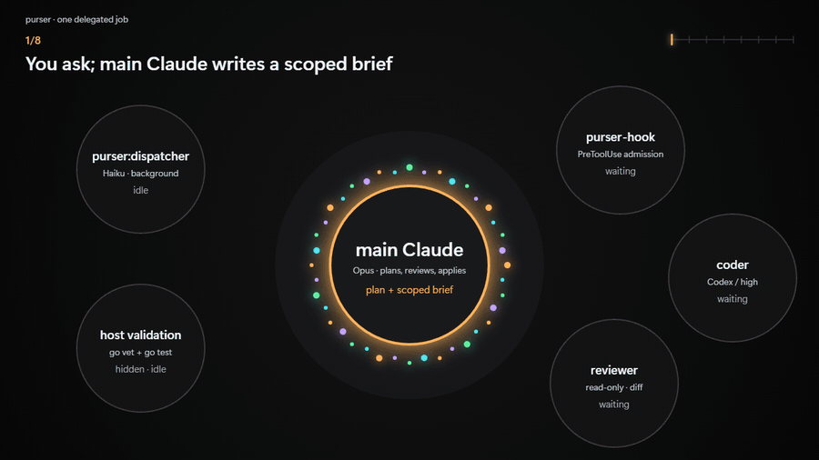
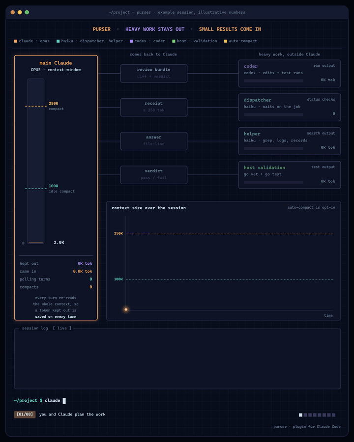

<div align="center">
<h1>Purser</h1>
<h4>Purser coordinates delegated coding work for Claude Code.</h4>

    [](https://github.com/neurot1ca/purser-claude-orchestrator/releases)

 ![Codex](https://img.shields.io/badge/Codex-supported-10A37F?logo=)   

Purser is a Claude Code plugin that hands coding tasks to background workers, which can run side by side. Claude stays in charge of planning, review, acceptance and apply, while configured coding agents write code in isolated Git worktrees.

**[Install](#install) · [How it works](#workflow) · [Commands](#commands) · [Docs](#documentation)**



</div>

<div align="justify">

## Overview

Workers receive a task brief with its scope and acceptance criteria, rather than the full main conversation. Purser selects a model and effort from the task's route.

You can also run Purser with Claude alone. Claude then writes the code as well, and each job still runs in the background with only the files it needs.

The coder can be Codex, Claude, Gemini through agy, Cursor, or any model that OpenCode supports.

## Supported agents

| Agent | Role |
| --- | --- |
| OpenAI Codex | Coder or reviewer, using the latest listed Codex models. |
| Claude | Main planner and final reviewer. It can also be the coder or an independent Haiku reviewer. |
| OpenCode | Coder or reviewer. When enabled, it also races free models on eligible mechanical chores. |
| Antigravity (agy) | Coder or reviewer, using a listed Gemini model. Research requests use Codex instead. |
| Cursor | Coder or reviewer. The reviewer runs only after a live check shows it cannot edit files, run commands, fetch the web or call MCP tools. |

You can set the Codex coder's thinking effort for new jobs to low, medium, high, or xhigh, or leave it on auto to follow Purser's routes.

## Built-in subagents

| Subagent | Role |
| --- | --- |
| `purser:dispatcher` | Runs at low effort on Haiku, starts one worker job, waits for it, and returns only its job ID, thread and terminal state. Main Claude collects the result, reviews it and applies accepted work. |
| `purser:helper` | Answers read-only lookups on Haiku, such as where a symbol is defined or what a log says. It never edits files and returns at most 300 tokens with evidence. |



## Install

| Requirement | Why |
| --- | --- |
| Claude Code | Purser coordinates work from inside Claude Code. |
| Node.js | Launches the MCP server. |
| Git | Workers use isolated Git worktrees. |
| An installed and authenticated CLI for each selected role | Use Claude alone, or install and authenticate `codex`, `agy`, `opencode`, or `cursor-agent` separately. Purser resolves the selected CLI from `PATH` or its configured executable. |

Purser ships prebuilt binaries for Windows, macOS, and Linux on amd64 and arm64. Bundled Go binaries run the hooks and commands.

Run these commands inside Claude Code:

```text
/plugin marketplace add neurot1ca/purser-claude-orchestrator
/plugin install purser@purser-claude-orchestrator
```

Restart Claude Code, then configure Purser:

```text
/purser:init
```

To update:

```text
/plugin marketplace update purser-claude-orchestrator
/plugin update purser@purser-claude-orchestrator
```

The same setup works on Windows, macOS and Linux. It can write global defaults to `~/.orchestrator/config.toml`, project roles to Purser's state folder, and project settings to `.orchestrator/profile.toml`. It asks whether to trust the project before running its profile commands. Run `/purser:check` to inspect binaries and CLI status. Runtime state defaults to `~/.claude/purser` (`~` is your user home, including on Windows).

## Coders

Main Claude defines the task contract, file boundaries and acceptance criteria, then starts a dispatcher. The dispatcher starts one worker with Claude's complete brief and waits for its terminal state. Workers edit files and run focused checks in isolated worktrees. Independent jobs can run in the background; in print/SDK sessions, sequential dispatchers wait in the foreground so the session stays open until the job finishes.

Jobs with overlapping write scopes wait in a queue. The dispatcher returns the job ID, thread and terminal state; main Claude calls `codex_result` once to collect the review bundle. Claude reviews the diff, scope checks, validation and reviewer findings, then calls `codex_apply` with the job ID and reviewed revision to accept and apply in one call. Repairs go back to the same worker thread through the dispatcher. The dispatcher does not collect results, review, accept or apply.

With a non-Claude coder selected, Purser normally denies main Claude's non-trivial edits to tracked code, including shell writes, and directs the task to the coder. Trivial edits remain allowed; a project can turn this guard off with `[roles] enforce_delegation = false`.

## Orchestrator

Main Claude plans and routes work, reviews finished jobs, evaluates reviewer findings, and approves changes for application. For a new implementation on a consequential or escalated route without a matching plan, Purser asks for `/purser:plan`. The planner inspects the repository and produces ordered milestones. You review and approve them before implementation; independent milestones can run side by side. Plans and progress are saved to disk and active milestones can be restored after session compactions or terminal restarts.

The reviewer is an automated second opinion. You choose an installed agent or turn it off; a different model family from the coder is required when the project sets `[review] require_different_family = true`. The reviewer gets an isolated packet with the diff, task criteria, test evidence and relevant context. It returns no material finding, changes required, uncertain, or reviewer unavailable. Review can be skipped for plan and operation phases, no-delta jobs, small diffs (by default at most 50 lines across two files), or a disabled or unavailable reviewer. Skips and failures stay explicit and never count as a passing review. Main Claude evaluates the result before accepting and applying the reviewed revision. Applying updates your working tree; creating a Git commit remains an explicit action for you and Claude.

The first review failure gets one same-thread send-back. If a luna implementation attempt is rejected after that send-back, Purser routes the next attempt to normal and records a short basis note. If a provider reaches quota limits or fails to launch, Purser presents diagnostic details and asks for consent before switching to a configured fallback coder. If you decline and wait, Purser records the reset time and wakes the session with "⚓ Codex quota renewed ✓" once it passes, so held work resumes without a message from you.

Read-only research has its own route. Codex uses GPT-6.1 Terra at medium effort by default, with Luna or Sol fallbacks when availability is verified. Its repository stays read-only while a separate scratch folder permits notes and clones. OpenCode research disables MCP servers, and agy research is redirected to Codex. Claude research runs read-only with MCP and browser integration disabled. Codex read-only planning launches also disable inherited MCP servers, connectors and browser tools. The reviewer is skipped as for other operation jobs, and Claude reviews the report fully.

Established operation runbooks, such as CI reruns, measurements, releases and test runs, use one synchronous `codex` call without a dispatcher. In long Desktop conversations, Purser asks Claude to move code changes, bug investigations and multi-file work to a fresh session with a self-contained brief, then archive it after the work lands.

## Job board

The job board tracks this project's worker jobs and Claude subagents. In Claude Desktop, the bar shows job counts and opens a Jobs details pane. It refreshes every five seconds and keeps the last board visible if a refresh fails.

- Agent pills: brand-colored `coder`, `reviewer` and `free` pills show the selected agents. The Codex coder pill includes its latest model and effort. The free pill shows the latest OpenCode model used in the last seven days; unknown or disabled choices are omitted. Pills wrap in narrow windows.
- Worker details: task, model and effort, state, elapsed time and ETA, reviewer status and apply outcome. States include coding, queued, fetching result, in review, accepted, done, failed and cancelled. Queued rows name the blocking job when known.
- Claude subagents: agent type, the model read from the subagent's own transcript, state and duration. Dispatcher rows also name their Purser task. The bar counts running subagents; the table has no token or excerpt columns.
- Finished rows: only the latest worker job per thread is shown. Finished worker rows hide after two board displays or one hour; a board with only previously displayed finished work can disappear sooner. Finished Claude subagent rows age out after one hour, and empty observation rows are omitted.

## Workflow

1. **Ask:** Request a feature or fix from Claude.
2. **Route and plan:** Main Claude chooses a route. A new implementation on a consequential or escalated route without a matching plan goes through `/purser:plan`; review and approve its milestones before implementation.
3. **Run in a worktree:** A dispatcher starts and waits for each worker. Independent steps can run concurrently; overlapping write scopes queue.
4. **Collect and review:** Main Claude collects the result once and reviews the diff, scope, validation and any reviewer findings. Unaccepted work can return to the same worker thread for repair.
5. **Apply and validate:** Main Claude accepts and applies the reviewed revision in one call, then waits for the returned host validation command's terminal result. A zero waiter exit alone is not a validation pass. Committing remains a separate decision; eligible finished worktrees are cleaned up later.

## Highlights

<table>
<tr><td><h3>Task briefs and results</h3><p>Each worker gets a bounded brief. The dispatcher returns only the job identity and terminal state; main Claude collects the review bundle. FULL review includes a complete small diff inline, or the exact path to the full diff when it is large or not plain text.</p></td></tr>
<tr><td><h3>Maintenance and cleanup</h3><p>When the project has been idle for five minutes and none of your jobs is running, an optional background cleaner scans the code and writes two reports: cleanup candidates (unused code) and missing tests. Each finding comes with evidence, a severity, and a path to the full report, and findings are sorted by importance. In Go projects, a built-in pre-scan first hands the worker findings for unchecked errors, ineffective assignments and unused unexported functions. For missing tests, the cleaner also writes them in an isolated worktree, aiming at the project's coverage target (<code>coverage_target_pct</code>, 90% by default). It measures coverage before and after on your machine for Go, Python, and JavaScript, has the patch reviewed, and keeps one test patch ready. Say "add tests" to apply it; your checkout stays as it is until then. The cleaner is opt-in per project, runs each report type at most once every 56 hours, and steps aside when you start a job. Turn it off with <code>purser-hook maintenance opt-out --repo &lt;repository-root&gt;</code>. Finished worktrees and temporary patch files are removed; active, unapplied, or conflicted work is kept.</p></td></tr>
<tr><td><h3>Honest test results</h3><p>Purser extracts host test evidence from worker logs, including commands, exit codes and output tails, and keeps the worker's report separately. Missing or ambiguous evidence stays UNKNOWN. Earlier failures remain context; tests before a later edit do not establish a pass. After apply, host validation checks the applied revision; Claude waits for its terminal result before committing.</p></td></tr>
<tr><td><h3>Code map</h3><p>Native Go and Python extractors and tree-sitter parsers map repository files and symbols across 17 language modes, including JavaScript/TypeScript, Rust, Java, C/C++, Swift and Kotlin. The map retains file paths when symbols must be trimmed, dropping test-file and older-file symbols first. Workers use it for navigation and verify the current source before relying on it.</p></td></tr>
<tr><td><h3>Contracts and change attribution</h3><p>Every implementation job starts with declared path boundaries. Purser snapshots Git state beforehand and attributes changes afterward, flagging edits to protected paths such as <code>.git</code> or environment files. These are contract checks; worker CLIs run with your standard user permissions.</p></td></tr>
<tr><td><h3>Handoff and auto-compact</h3><p>Purser keeps a short handoff note with the goal, state, decisions, next step, open risks, files to load, and user language. Before Claude compacts, it updates the note with recent commits, jobs, and the active plan step. A normal session start points to the handoff file; after compact or <code>/clear</code>, the note is restored in full; a note older than 12 hours is not restored, and the restored conversation excerpt contains only recent turns and the reply language. Auto-compact is optional; <code>/purser:init</code> asks whether to turn it on. Purser compacts at the end of a turn once the context reaches 250K tokens (set <code>PURSER_AUTO_COMPACT_TOKENS</code> to change it, or <code>0</code> to turn it off) and continues with the note, reporting context before and after. About 30K tokens before that point, Claude is asked to update the note, and a note left unchanged since the last compaction comes back marked as stale. From 100K tokens, an idle conversation is checked every minute and compacted shortly before Claude's prompt cache expires: 30 seconds before a 5-minute cache, 5 minutes before a 1-hour cache. From 200K tokens, Purser leaves an idle conversation to Claude Code's own idle compaction, unless the <code>idleCompaction</code> setting turns it off. Each decision is logged in <code>auto-compact.log</code> in Purser's state folder.</p></td></tr>
<tr><td><h3>Model routing and capacity</h3><p>Purser picks the model tier from the route: routine chores go to lighter models, and subtle fixes, features and design work go to stronger ones. <code>/purser:gear-up</code> temporarily elevates eligible Codex jobs to a configured higher gear; <code>/purser:gear-down</code> returns them to baseline. Route selection is rule-based.</p></td></tr>
<tr><td><h3>Free OpenCode model race</h3><p>When enabled, Purser uses OpenCode's free models for eligible mechanical chores. New models run a built-in task bracket in the background; the bracket winner races the current leader on shadow runs. Purser ranks results with the smoothed score <code>(successes+1)/(samples+2)</code>. A newcomer can win after three samples, and the leader changes only on a race win. Live jobs use their own worktree and normal scope check and review rules. Shadow runs use scratch files, which the benchmark lets the model edit and then scores. Only mechanical chores go to free models; work needing judgment stays with your main coder.</p></td></tr>
<tr><td><h3>Other tools</h3><p>The bar shows active model limits, reset countdowns and reported session costs. The <code>/purser:optimize</code> command reports plugin, skill and MCP server use in recent sessions so you can inspect what is loaded. When a turn stops on the Claude usage limit, Purser sends "⚓ Claude usage renewed ✓" a minute after the limit resets, and Claude picks up the interrupted work where it stopped. A message from you before then cancels it, and the session has to stay open for it to fire.</p></td></tr>
</table>

## Commands

| Command | Description |
| --- | --- |
| `/purser:auto-compact` | Turn Purser's automatic `/compact` on or off for all projects. |
| `/purser:check` | Check whether Purser is installed and usable. |
| `/purser:coder-effort` | Set the Codex coder's thinking effort for new jobs (low, medium, high, xhigh), or auto to follow Purser's routes. |
| `/purser:gear-down` | Return this project to its normal Codex gear. |
| `/purser:gear-up` | Use the faster project gear for new Codex jobs. |
| `/purser:init` | Set up Purser roles and optional project trust and profile. |
| `/purser:optimize` | Inspect plugin, skill and MCP server use and prompt loads in recent sessions. |
| `/purser:plan` | Ask the configured coder for a read-only, evidence-based implementation plan. |
| `/purser:reviewer` | Choose a reviewer from the installed agents, or turn it off. |

The bundled `codex-orchestrator` skill supplies delegation and review guidance alongside these nine commands.

## How Purser compares

Purser is a Claude Code plugin that coordinates installed coding CLIs. It includes worktree creation, scope queues, model routing, reviewer checks, acceptance, apply and host validation. Claude remains the orchestrator; selecting another coder does not replace the main Claude session. Purser leaves commits and pushes to you and Claude.

## Frequently asked questions

<details>
<summary>Does Purser provide its own AI models?</summary>

No. Purser is an orchestration plugin. It coordinates Claude Code with the coding CLIs installed on your machine, including OpenAI Codex and Claude Code.
</details>

<details>
<summary>Do I need anything besides Claude Code?</summary>

You need Node.js and Git. Claude can fill the coder and reviewer roles; other selected CLIs must be installed and authenticated separately. Purser ships native binaries for Windows, Linux and macOS on amd64 and arm64.
</details>

<details>
<summary>Can I use Claude alone?</summary>

Yes. Select Claude as the coder during setup. Main Claude still plans and reviews, and delegated Claude workers run the coding jobs. You can select an independent reviewer or leave that role off.
</details>

<details>
<summary>Can background workers edit files outside their declared scope?</summary>

Tasks define explicit path boundaries, and Purser flags any out-of-scope or protected file. These boundaries are contract checks; worker CLIs run with your standard user permissions.
</details>

<details>
<summary>Is an independent review the same as accepting code?</summary>

No. The reviewer provides an advisory second opinion; a different family is required only when the project enables that rule. Main Claude evaluates the findings and accepts and applies the reviewed revision. Skipped or unavailable review is never a passing review.
</details>

<details>
<summary>What happens if my terminal closes during a task?</summary>

Purser records job state and process identifiers on disk. If your terminal closes or your system restarts, startup checks reconcile active processes and report unfinished work. Main Claude can explicitly adopt a durable result from the same project; a closed session is not a promise that its worker will resume automatically.
</details>

## Bug reporting

Report bugs on [GitHub Issues](https://github.com/neurot1ca/purser-claude-orchestrator/issues).

## Develop and contribute

```bash
git clone https://github.com/neurot1ca/purser-claude-orchestrator.git
cd purser-claude-orchestrator/go && go test ./...
```

The Go module is `purser-hook`; contributions follow the repository's development guidance.

## Documentation

| Document | Description |
| --- | --- |
| [Plugin setup](docs/PLUGIN.md) | Plugin source and local release marketplace setup. |
| [Changelog](CHANGELOG.md) | Plugin release history. |

## What Purser does on your machine

Purser runs locally without a hosted Purser service. The [privacy policy](PRIVACY.md) sums up what it reads, sends and stores.

It runs a bundled Go binary, `purser-hook`, built for your operating system and architecture. Claude Code hooks and Purser's MCP server start it. It also runs the coder CLIs you set up in `/purser:init`: Codex, OpenCode, agy, Cursor or Claude. Windows worker launches suppress console windows; macOS and Linux use detached processes. State and config replacements retry brief file locks, including Windows antivirus or indexer locks.

It reads the repository you work in, the Claude Code hook events of your session (tool calls, prompts, session and tool-use IDs), the session's usage and cost figures, Claude subagent lifecycle events and local transcripts used for job and usage evidence, and its own state files.

It sends each worker's brief, and whatever repository content that worker reads, to the worker's provider, under that provider's terms. Its measurements stay on your machine. It downloads the public model list from models.dev to rank models and checks GitHub once a day for a newer Purser release (set `PURSER_NO_UPDATE_CHECK=1` to turn this off). Set `PURSER_DISABLE_CATALOG_REFRESH=1` to disable the session-start catalog refresh. CLI model discovery and the optional free-model race also invoke providers through their CLIs.

It writes job records, plans, handoff notes, logs and measurements under `~/.claude/purser/`, under `CLAUDE_CONFIG_DIR/purser` when that variable is set, or under `PURSER_STATE_DIR` when you override it. Job worktrees live there too; Git records each one in your repository's `.git` folder. `/purser:init` can save global defaults in `~/.orchestrator/config.toml`, project roles in `projects/<project-key>/roles.toml` under the state folder, and project settings in `.orchestrator/profile.toml` in your repository. The normal apply path requires review and acceptance, and Purser never commits or pushes. If a worker writes in-scope changes to the main checkout while leaving its worktree empty, Purser can move those changes into the worktree for normal review and apply; scope checks detect other unexpected writes. If you name an Obsidian vault, Purser also writes telemetry notes there.

It also applies retention limits to its own data. Eligible raw tool outputs and review bundles are removed after 7 days, finished job worktrees once their job is closed, and other records when they pass an age or size cap. Active or unresolved work is retained. It also removes old Purser versions from Claude Code's plugin cache after an update. Cleanup removes aged Purser-prefixed scratch entries from its temporary directory and prunes the Git records of retired worktrees.

It adds routing guidance and a handoff reference at normal session start, restores the handoff after compact or clear, adds a reply-language reminder with prompts, and supplies a job board after Purser tool calls. Fresh Desktop sessions started with a self-contained brief do not inherit the earlier session's handoff.

It can submit three kinds of prompts for you. With auto-compact turned on (it stays off unless you enable it in `/purser:init` or with `/purser:auto-compact`), Purser sends `/compact` at the end of a turn once the context reaches its threshold (250K tokens by default), or when a conversation from 100K tokens stays idle until its prompt cache is about to expire (from 200K, Purser defers to Claude Code's native idle compaction unless that setting is disabled). A minute after a held Codex quota resets, it sends "⚓ Codex quota renewed ✓" so held work resumes. When the Claude usage limit stops a turn, it sends "⚓ Claude usage renewed ✓" a minute after the limit resets, unless you write first.

Its PreToolUse hook checks delegated calls and main Claude's code edits against the Purser workflow. It can deny a call with a reason, and it publishes the identity handoff required by Purser's MCP server. Failed handoff publication blocks the call. The hook does not grant permission or rewrite tool input; the MCP server applies routing and scope rules to Purser's own tools. Post-tool hooks attach review and validation evidence; an observation failure requires FULL Claude review.

### What the hooks module does

The plugin directory review covers each point below.

- **Programs it starts.** The TypeScript hooks resolve the bundled `purser-hook` binary for the host OS and CPU. If environment variables do not identify the platform, they run `uname -s -m`; board and language hooks also run `git rev-parse --show-toplevel`. The Go binary starts Git, configured coder and reviewer CLIs, and validation commands.
- **Binaries.** The platform binaries in `bin/` are built from `go/` by `.github/workflows/release.yml`; release packaging produces checksums.
- **What it sends and where.** Hook events go to the local binary on standard input. The TypeScript hooks do not make remote HTTP requests themselves. The binary and provider CLIs perform the model discovery, release checks and delegated work described above.
- **Permission hook.** `hooks/mod/enforcement.ts` checks main-session code edits and publishes delegated tool identity through the binary. It can deny calls and never grants an allow decision. Async admission and handoff publication fail closed; synchronous enforcement bypasses and post-hook observation failures are marked for FULL Claude review. Claude Code's own permission mode still applies.
- **Prompts it submits.** With auto-compact enabled, `hooks/mod/autocompact.ts` submits `/compact` and the fixed resume line "⚓ /compact ✓". Separately, `hooks/mod/quotawake.ts` submits the fixed Codex and Claude quota-reset wake lines described above. Those wake prompts do not require auto-compact. The hooks attach instructions to the resume prompts.
- **Prompt hook.** Auto-compact tracks user activity and avoids treating its own resume prompt as a new idle period. Language and quota hooks can add context to prompts; they do not rewrite the user's text.
- **Context and tool results.** Lifecycle hooks supply routing and handoff context. Post-tool hooks can add context and replace Purser tool output with the review bundle. Board and usage hooks render the bar and Jobs pane; Claude work hooks observe subagent start, stop and session end.
- **Files it writes.** The TypeScript auto-compact hook writes `auto-compact.log` in the state folder. Calls into the Go binary also persist job, handoff, enforcement, quota and Claude work records there; the hooks are not limited to a single log file.
- **Credentials.** Coder CLIs use their own sign-in. Purser reads local CLI configuration for discovery and confinement, and usage records for the bar. The optional remote bridge requires its own `PURSER_REMOTE_TOKEN` and validates incoming requests against it. The `GH_TOKEN` in `.github/workflows/release.yml` is for release CI.

## Telemetry

Purser measures local job details such as route, model, duration, tokens, reviews, send-backs, queue waits, and stalls, and keeps the records on your machine. It uses them to update job time estimates; ETA estimates and free-model rankings learn from past runs. For more detail, it can write telemetry notes to an Obsidian vault when `PURSER_OBSIDIAN_VAULT` or `vault_root` is set to an absolute path, where you can inspect which jobs ran, how they were reviewed, and where time and tokens went.

## License

Licensed under either the [MIT License](LICENSE-MIT) or [Apache License 2.0](LICENSE-APACHE).

</div>
